<p align="center">
  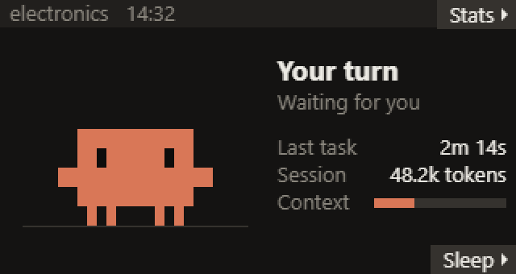
</p>

<h1 align="center">Claude Buddy</h1>

<p align="center">
  <b>A tiny desk companion for <a href="https://claude.com/claude-code">Claude Code</a>.</b><br>
  It shows what Claude is doing, and lets you approve commands and answer Claude's questions<br>
  with the two buttons on a LilyGO T-Display-S3.
</p>

<p align="center">
  
  
  
  
</p>

> [!NOTE]
> An unofficial fan project, not affiliated with or endorsed by Anthropic. The pixel character is a fan
> recreation of the Claude Code mascot.

---

## What it does

- **Live status.** Thinking, working (which tool, which file), task progress, tokens used, how full the context is.
- **Permission prompts on the board.** Pick **Allow**, **Deny** or **Always allow** with the buttons. The prompt also
  shows in the Claude app as usual, and whichever you answer first wins.
- **A safety hold for risky commands.** `rm -rf`, `git push --force`, `git reset --hard` and similar need a
  1-second hold. A quick tap only shows a reminder; it never approves anything.
- **Claude's questions.** Answer multiple-choice questions (also multi-select, and several questions in a row) on
  the board. If you don't answer within 30 s, the question moves to the app.
- **Several sessions at once.** Prompts queue up, and the board shows "+1 waiting".
- **Token stats** for today, with a chart of the last 12 hours.
- **Private.** Everything stays on your PC: the bridge only listens on `127.0.0.1`.

## Meet the buddy

<p align="center">
  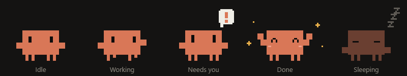
</p>

<details>
<summary><b>All the sprites</b></summary>
<p align="center">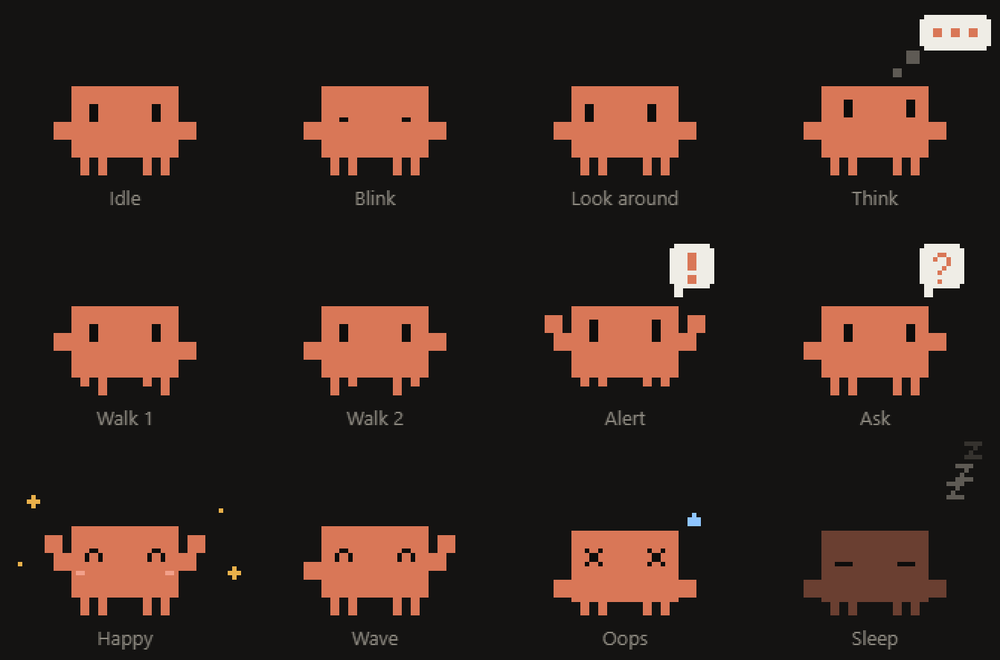</p>

The character is drawn from rectangles on a 36 x 20 grid (see `firmware/Claude-Buddy/mascot.h`), so every pose
is just a few lines of code and scales cleanly.
</details>

## Screens

<table>
  <tr>
    <td></td>
    <td>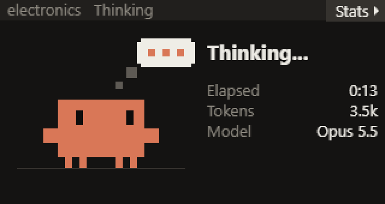</td>
  </tr>
  <tr>
    <td align="center"><b>Your turn</b>: waiting for your message</td>
    <td align="center"><b>Thinking</b></td>
  </tr>
  <tr>
    <td>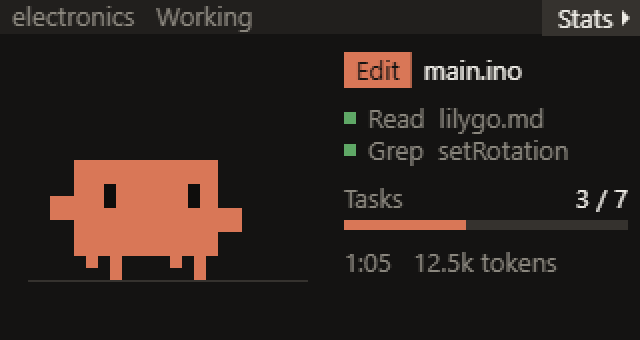</td>
    <td>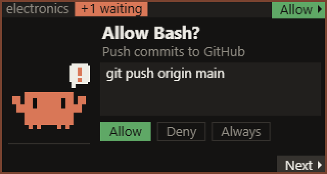</td>
  </tr>
  <tr>
    <td align="center"><b>Working</b>: tool, file, recent steps, task progress</td>
    <td align="center"><b>Permission prompt</b>: bottom moves, top picks</td>
  </tr>
  <tr>
    <td>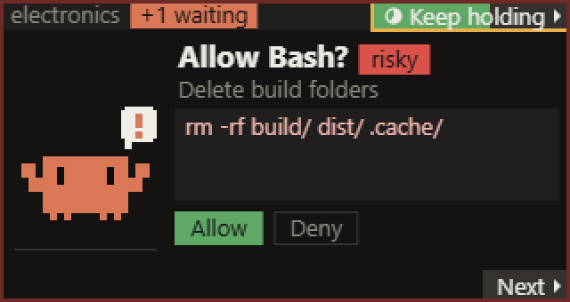</td>
    <td>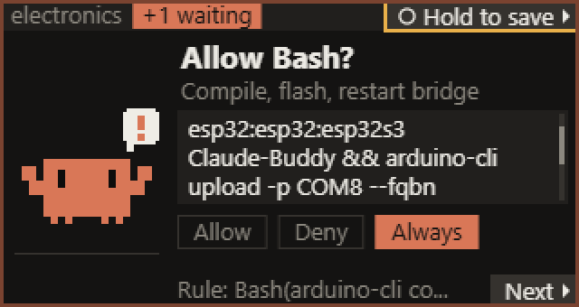</td>
  </tr>
  <tr>
    <td align="center"><b>Risky command</b>: hold 1 s, the ring fills up</td>
    <td align="center"><b>Long command</b>: scrolls by itself; <b>Always</b> shows the rule it saves</td>
  </tr>
  <tr>
    <td>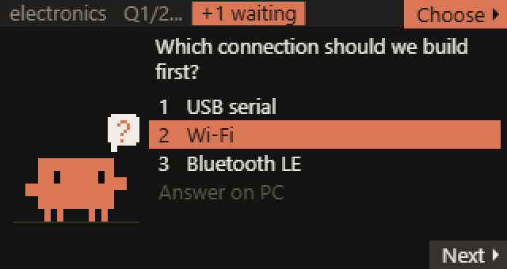</td>
    <td>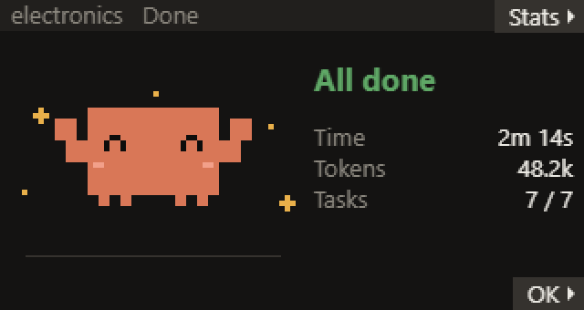</td>
  </tr>
  <tr>
    <td align="center"><b>Question</b>: with a countdown before it moves to the app</td>
    <td align="center"><b>Done</b></td>
  </tr>
  <tr>
    <td>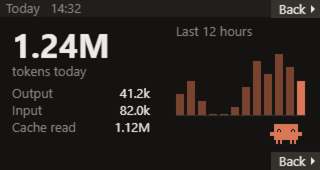</td>
    <td>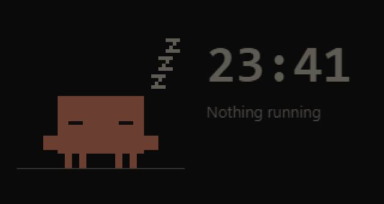</td>
  </tr>
  <tr>
    <td align="center"><b>Stats</b>: tokens today and per hour</td>
    <td align="center"><b>Sleep</b>: dims itself after 10 minutes of quiet</td>
  </tr>
</table>

---

## What you need

| | |
|---|---|
| **Board** | [LilyGO T-Display-S3](https://github.com/Xinyuan-LilyGO/T-Display-S3): ESP32-S3R8, 16 MB flash, 8 MB OPI PSRAM, 1.9" 170 x 320 ST7789 screen, two buttons. Tested on the non-touch version. |
| **Cable** | A USB-C cable that carries data, not only power. |
| **PC** | Windows 10/11 with Claude Code: the Code tab of the Claude desktop app, or the `claude` CLI. The bridge is plain Python and should also run on macOS and Linux, but the installer's "start with Windows" step is Windows-only. |
| **Python** | 3.10 or newer from [python.org](https://www.python.org/downloads/), for the PC bridge. |

No battery or soldering needed: the board runs from USB.

## Install

There are two parts: the **firmware** on the board and the **bridge** on your PC.

### 1. Flash the firmware

#### Option A: from the browser, no Arduino needed (easiest)

1. Download **`claude-buddy-t-display-s3.bin`** from the [latest release](../../releases/latest).
2. Open **[espressif.github.io/esptool-js](https://espressif.github.io/esptool-js/)** in Chrome or Edge.
3. Plug in the board, click **Connect**, and pick its port ("USB JTAG/serial debug unit").
4. Set the flash address to **`0x0`** (not the default `0x1000`), choose the `.bin` file, and click **Program**.
5. When it finishes, press the board's **RST** button.

> If **Connect** doesn't find the board, put it in download mode: hold **BOOT**, tap **RST**, release **BOOT**, and try again.

#### Option B: Arduino IDE (if you want to change the code)

1. Install [Arduino IDE 2](https://www.arduino.cc/en/software).
2. In **Boards Manager**, install **esp32 by Espressif Systems** version **`2.0.14`**.
   Use 2.0.14, not 3.x: TFT_eSPI crashes on the 3.x cores.
3. Get the display library configured for this board: download the
   [LilyGO T-Display-S3 repo](https://github.com/Xinyuan-LilyGO/T-Display-S3) (**Code > Download ZIP**) and copy
   everything inside its `lib` folder into `Documents/Arduino/libraries`. This installs **TFT_eSPI** already set up
   for the T-Display-S3.
4. Open `firmware/Claude-Buddy/Claude-Buddy.ino` from this repo.
5. Choose these settings in the **Tools** menu:

   | Setting | Value |
   |---|---|
   | Board | ESP32S3 Dev Module |
   | USB CDC On Boot | Enabled |
   | CPU Frequency | 240MHz (WiFi) |
   | Flash Mode | QIO 80MHz |
   | Flash Size | 16MB (128Mb) |
   | Partition Scheme | 16M Flash (3MB APP/9.9MB FATFS) |
   | PSRAM | **OPI PSRAM** |
   | Upload Mode | UART0 / Hardware CDC |
   | USB Mode | Hardware CDC and JTAG |

6. Click **Upload**. If it fails: hold **BOOT**, tap **RST**, release **BOOT**, upload again, then press **RST**.

<details>
<summary>Or with <code>arduino-cli</code></summary>

```bash
arduino-cli compile --upload -p COM8 --fqbn "esp32:esp32:esp32s3:USBMode=hwcdc,CDCOnBoot=cdc,CPUFreq=240,FlashMode=qio,FlashSize=16M,PartitionScheme=app3M_fat9M_16MB,PSRAM=opi" firmware/Claude-Buddy
```
Replace `COM8` with your board's port.
</details>

#### First start

The board shows a **Setup** screen. Hold it with the USB cable on the right and **press the button nearest the
top-right corner**; the board remembers which button is on top. If the picture is upside down, hold both buttons
for 2 seconds first. To run Setup again later, hold both buttons for 3 seconds.

Then it shows **"Waiting for PC"**. Press the top button to try the **demo**: it goes through every screen, and you
can try the buttons on the prompts.

### 2. Install the bridge on your PC

1. Download this repo (**Code > Download ZIP** and unzip it), or clone it:
   ```bash
   git clone https://github.com/yep606/claude-buddy.git
   ```
2. Open a terminal in the `bridge` folder and install the one dependency:
   ```bash
   python -m pip install -r requirements.txt
   ```
3. Run the installer:
   ```bash
   python install.py
   ```
   It does three things:
   - adds HTTP hooks to `~/.claude/settings.json`, after backing it up;
   - adds a **Claude Buddy** shortcut to your Windows Startup folder, so the bridge starts hidden when you log in;
   - starts the bridge now.
4. Start a new Claude Code session and the board comes to life. Sessions that were already running pick up the
   hooks too.

| Command | What it does |
|---|---|
| `python install.py --remove` | Undo everything: remove the hooks and the startup shortcut, and stop the bridge |
| `python install.py --project C:\path\to\project` | Add the hooks to one project folder only; then run `python bridge.py` yourself |
| `python bridge.py status` | Show what the bridge knows: board port, sessions, waiting prompts |
| `python bridge.py pause` | Free the COM port for 3 minutes, for uploading new firmware (the installer also writes `Pause buddy for upload.cmd`) |
| `python bridge.py stop` | Quit the running bridge |
| `python bridge.py --debug` | Run with a console and log every line sent to and from the board |

---

## Using it

| Screen | Top button | Bottom button |
|---|---|---|
| Your turn / Thinking / Working / Done | Stats | Sleep (Done: OK) |
| **Permission prompt** | Pick the highlighted choice | Next choice; **hold** to scroll a long command |
| Risky command, or **Always allow** selected | **Hold 1 s** | Next choice |
| **Question** | Choose (multi-select: tick, then "Send answers") | Next item; **hold** to scroll the question |
| Stats | Back | Back |
| Stopped (error) | | OK |
| Waiting for PC | Demo | |
| Anywhere outside a prompt | Hold **both** for 3 s: Setup | |

The labels in the right-hand corners always say what the button next to them will do.

**Good to know**
- **Permission prompts show on the board and in the app at the same time.** Answer either one; the other closes.
- **Questions go to the board first.** Claude Code asks the bridge before it shows a question, so while the board
  holds it (up to 30 s) the app doesn't show it. Pick **Answer on PC** to move it to the app right away. If the board
  isn't connected, questions go straight to the app.
- **"Always allow"** saves the rule Claude Code suggests (for example `Bash(git push *)`), exactly like the button in
  the app. It isn't offered for risky commands.
- **A press that started before a prompt appeared can't answer it**, so a click meant for another screen never
  approves anything.

## How it works

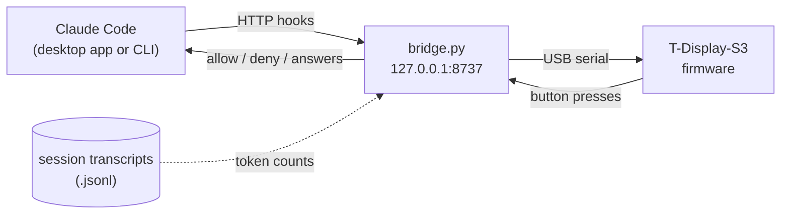

- **Claude Code hooks.** At key moments (a prompt is sent, a tool starts or finishes, a permission is needed, a
  question is asked, the turn ends), Claude Code POSTs the event to the bridge on `127.0.0.1`.
- **The bridge** (`bridge/bridge.py`) keeps track of every session, picks what the board should show, queues
  prompts, and turns your button presses into the answers Claude Code expects. It reads token counts from the
  session transcripts that Claude Code writes. If the bridge isn't running, Claude Code carries on as normal.
- **The firmware** (`firmware/Claude-Buddy`) draws the screens at 30 fps into a full-screen sprite, handles the
  buttons, and talks to the bridge with short tab-separated text lines. The protocol is documented at the top of
  [`protocol.h`](firmware/Claude-Buddy/protocol.h).

## Troubleshooting

| Problem | Fix |
|---|---|
| The board says **"Waiting for PC"** | The bridge isn't running. Check with `python bridge.py status`, then start it with `python bridge.py` (or log out and back in after `install.py`). |
| Arduino upload fails: **port busy** | The bridge is holding the port. Run `python bridge.py pause` (or `Pause buddy for upload.cmd`), then upload. |
| Black screen, or **"Sprite failed"** | Set **PSRAM: OPI PSRAM** and upload again. |
| Claude shows **"hook error ... ECONNREFUSED"** | The hooks are installed but the bridge isn't running. It's harmless; start the bridge or run `install.py --remove`. |
| The board isn't found | Use a data cable. In Device Manager it should appear as **"USB Serial Device"**; the bridge finds it by its USB ID (`303A`). |
| Picture upside down, or the buttons are swapped | Hold both buttons for 3 s to run Setup, then hold both for 2 s to flip the picture. |

> [!WARNING]
> **Battery:** the T-Display-S3 charges at about 500 mA whenever USB is plugged in, too much for very small cells.
> Claude Buddy runs fine from USB alone. If you add a battery, use a protected LiPo of at least 500 mAh and check
> the polarity first.

## Project layout

```
claude-buddy/
├── firmware/Claude-Buddy/    Arduino sketch (C++)
│   ├── Claude-Buddy.ino        setup() and loop()
│   ├── mascot.h                the pixel character and its props
│   ├── screens.h               one function per screen
│   ├── input.h                 the two buttons, hold-to-confirm, Setup
│   ├── protocol.h              USB serial protocol (documented at the top)
│   ├── demo.h                  demo mode
│   └── config.h, state.h, ui.h, logic.h
├── bridge/
│   ├── bridge.py               the PC side: hooks in, board out
│   ├── install.py              adds/removes hooks and autostart
│   └── requirements.txt
└── docs/images/              screenshots, sprites and animations for this README
```

## License

[MIT](LICENSE) © 2026 Ilya Rogov. Built with Claude Code.
